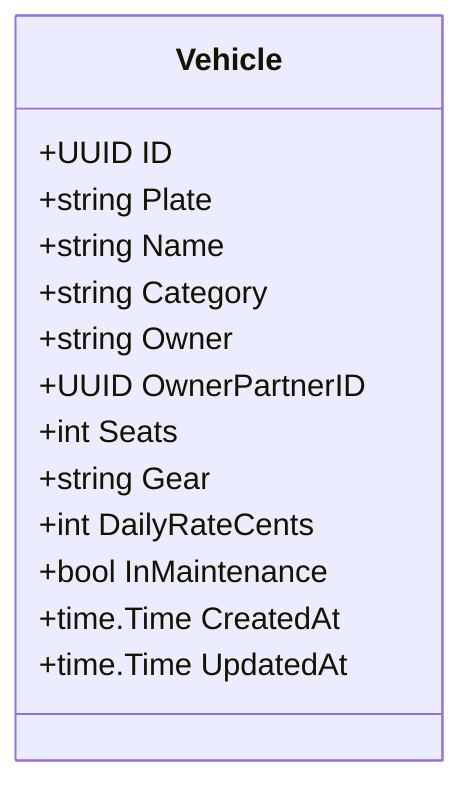

# RN-01 — Frota

## Regras de Negócio

| ID | Regra | Status | Onde é aplicada | Pendências |
|---|---|---|---|---|
| RN-01.1 | Veículo em manutenção não aceita reservas, e esse estado prevalece sobre qualquer outro na exibição | implementada (05/11/2026) | `internal/domain/booking/repository/booking_repository.go:186` (recusa a reserva), `queryAvailable` (fora da disponibilidade). Manutenção é um estado do veículo, sem período | PEN-01 |
| RN-01.2 | Cada veículo tem uma tarifa diária própria, cadastrada pela central | implementada (05/11/2026; diária no veículo, e não na categoria, decidido pelo time) | `sql/migrations/V2_vehicles.up.sql:10`, `internal/domain/fleet/entity.go:52` (diária obrigatória, sem default) | PEN-02 |
| RN-01.3 | O estado exibido do veículo considera reservas futuras, não só a locação em curso: com reserva futura, a frota mostra **"Reservado" e a próxima reserva** | implementada (06/11/2026; aprovada no mesmo dia, q81) | `internal/domain/fleet/repository/fleet_repository.go` (`queryVehicles`: estado e próxima reserva) | PEN-28 |
| RN-01.4 | Categorias de veículo: **Economy** e **Premium**, por enquanto | implementada (05/11/2026; aprovada em 03/11/2026, [ADR-0011](../../docs/adr/ADR-0011-escopo-de-lancamento-e-canais.md)) | `internal/domain/fleet/entity.go:11`, `CHECK` em `V2_vehicles.up.sql` | PEN-61 |
| RN-01.5 | Valores comerciais são **configurados pela operação**, nunca fixos no código: diária do aluguel, referência de preço do transfer, hora extra de espera, caução, franquia, percentuais de comissão e repasse e **limite de km por dia** (RN-02.18) | aprovada (04/11/2026, fundador: "deixe de forma configurável"; [ADR-0013](../../docs/adr/ADR-0013-pagamento-online-e-moedas.md); km em 05/11/2026) | — | PEN-02 |
| RN-01.6 | Depois da devolução, o veículo só volta a ficar disponível (e só sai para nova locação) com o **checklist de devolução aprovado**. Lista inicial: combustível, estética, nível de óleo, água, pastilhas de freio, **pneus, limpeza interna, documentos no carro, fotos obrigatórias e quilometragem**. Os itens são **configuráveis** pela operação | implementada (06/11/2026; aprovada em 05/11, q56, e itens extras em 06/11, q80) | `sql/migrations/V4_checklist.up.sql` (lista inicial), `internal/domain/checklist` (configuração), `internal/domain/booking/entity.go` (`stageChecks`: itens exigidos em "devolvida"), `booking_repository.go` (`queryChecklistPending`: não entrega com checklist pendente); fotos da entrega e da devolução na reserva, e o item `fotos` só é marcado com ao menos uma foto da devolução ("Fotos obrigatórias", q80; `booking_service.go`, `SetChecks`) | PEN-18 |
| RN-01.7 | O cadastro do veículo aceita **fotos**. Até haver fotos da frota, o site usa imagens ilustrativas | implementada (06/11/2026; aprovada em 06/11, q85): várias fotos por veículo, a primeira é a capa; a landing lista os carros fora de manutenção com a capa (fundo iluminado enquanto carrega ou sem foto) | `V16_photos.up.sql`, `internal/domain/photo`, [ADR-0014](../../docs/adr/ADR-0014-armazenamento-de-fotos.md) (bucket privado) | PEN-65 |
| RN-01.8 | **Ficha do carro**: ano, cor, combustível, portas, itens (ar-condicionado, multimídia, câmera de ré e outros) e descrição, opcionais. O site tem uma **página por carro** (galeria, ficha, itens, descrição e pedido), no estilo dos classificados (Webmotors); carro em manutenção não aparece | implementada (06/11/2026; fundador no CLI: campos marcados e referência ao Webmotors) | `V18_vehicle_details.up.sql`, `fleet/entity.go` (`Features`, `Fuels`), `GET /api/public/fleet/:id`; `neonflow-app`: `/carros/:id` | PEN-65 |
| RN-01.9 | A página do carro **não mostra preço**: segue a LuxuryBus, em que a frota não tem valor e o preço aparece na reserva. A central informa a diária no pedido | aprovada (06/11/2026, fundador no CLI: "Siga o mesmo exemplo que existe no site luxurybus.ch"); interpretação a confirmar, porque a q07 dizia "aluguel de veículos fica visível" | `neonflow-app`: `CarPage` (sem valor) | PEN-02 |
| RN-01.10 | **Ficha interna do carro** no painel, com mais detalhes que o site: **histórico de manutenção** (data, tipo, o que foi feito, custo, km, oficina), desempenho dos últimos 12 meses (reservas, dias alugados, ocupação, receita, km rodados, manutenção, resultado) e as reservas; e um **comparativo da frota** para ver qual carro sai mais e qual dá mais manutenção | implementada (06/11/2026; fundador no CLI: "historico da manutenção do veiculo [...] qual carro é melhor, qual carro sai mais ou da mais manutenção") | `V18_vehicle_details.up.sql` (`vehicle_maintenance`), `internal/domain/maintenance`, `fleet_repository.go` (`queryStats`); `neonflow-app`: `/frota/:id`, `FleetComparison` | — |

**Fontes:** Dossiê F; Base v1.1 §4; código do protótipo; questionário do fundador em 03/11/2026 (RN-01.4), 04/11/2026 (RN-01.5), 05/11/2026 (RN-01.6, dono dos veículos) e 06/11/2026 (RN-01.3, RN-01.6, RN-01.7); CLI em 06/11/2026 (RN-01.8 a RN-01.10).

## Detalhes

- Não há bloqueio de manutenção por período, só o estado global do veículo. O tratamento de clientes afetados por manutenção inesperada não está definido (Dossiê F).
- Frota informada pelo fundador: **VW Jetta 2014 (Economy)** e **Mercedes-Benz C180 (Premium)** (03 e 04/11/2026), **os dois de parceiros** (05/11/2026), então o repasse ao dono (RN-03.6, RN-03.7) vale para toda a frota atual. Faltam documentos e situação (PEN-01). São dados de cadastro, não seed de código. Em 06/11/2026 (q96) o fundador informou **caução de R$ 350 e limite de 200 km por dia nos dois carros**, configuráveis; o valor do km excedente não foi informado; desde a V10 o limite pode ser cadastrado sem ele (km controlado, valor a definir pela central, RN-02.18).
- RN-01.6 cria um estado entre "devolvido" e "disponível": o veículo aguarda o checklist. O carro pode sair de novo **no mesmo dia**, desde que o checklist esteja aprovado (RN-02.25), sem intervalo fixo de limpeza.
- RN-01.6: na q80 o fundador colou a vistoria da Localiza, que confere o carro **também na retirada** (lataria, pneus, interior, acessórios, avarias já existentes, assinatura do cliente). Um checklist de retirada não foi decidido explicitamente; a etapa "confirmada → em locação" hoje só tem a conferência `delivery` (PEN-18).
- Estados de exibição (RN-01.1, RN-01.3, RN-01.6): manutenção prevalece; depois em locação; aguardando checklist; reservado (com a próxima reserva); livre.
- RN-01.2 × RN-01.5: decidido em 05/11/2026 que a diária fica no veículo, editável pela central (`PUT /api/vehicles/:id`). O limite de km por dia (RN-02.18) e os itens do checklist (RN-01.6) ainda não têm cadastro. As tarifas do protótipo (R$150–320) são **inventadas** e não podem ir para o produto.

## Modelo (alvo)

Campos baseados no protótipo (`dist/data.js`). Documentos do veículo (CRLV, seguro) dependem de PEN-03.
- RN-01.10: o **resultado** do comparativo é receita das locações (diárias + atraso + km) menos o custo de manutenção registrado. Não desconta repasse ao dono, comissão, combustível nem outros custos; serve para comparar os carros entre si, não como lucro. Ocupação = horas com o carro fora (hora real quando registrada) ÷ horas do período.
- RN-01.10 × RN-03.5: o custo de manutenção do carro parceiro é do dono; o registro é informativo para a comparação.
