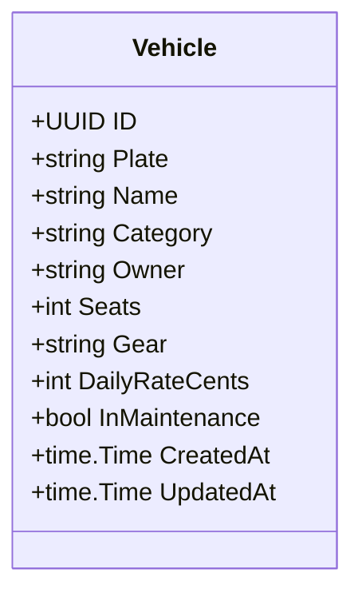

# RN-01 — Frota

## Regras de Negócio

| ID | Regra | Status | Onde é aplicada | Pendências |
|---|---|---|---|---|
| RN-01.1 | Veículo em manutenção não aceita reservas, e esse estado prevalece sobre qualquer outro na exibição | protótipo | `../neonflow-app/prototipo/dist/app.js:41` (`createBooking`), `app.js:20` (`vehicleState`) | PEN-01 |
| RN-01.2 | Cada veículo tem uma tarifa diária própria, cadastrada pela central | protótipo | `../neonflow-app/prototipo/dist/data.js` (`rate` por veículo) | PEN-02 |
| RN-01.3 | O estado exibido do veículo considera reservas futuras, não só a locação em curso | proposta | — (o protótipo mostra "Livre" com reserva confirmada) | PEN-28 |

**Fontes:** Dossiê F; Base v1.1 §4; código do protótipo.

## Detalhes

- Não há bloqueio de manutenção por período, só o estado global do veículo. O tratamento de clientes afetados por manutenção inesperada não está definido (Dossiê F).
- A frota real (veículos próprios e de parceiros) ainda não foi inventariada (PEN-01). As tarifas do protótipo (R$150–320) são **inventadas** e não podem ir para o produto.

## Modelo (alvo)

Campos baseados no protótipo (`dist/data.js`). Documentos do veículo (CRLV, seguro) dependem de PEN-03.
