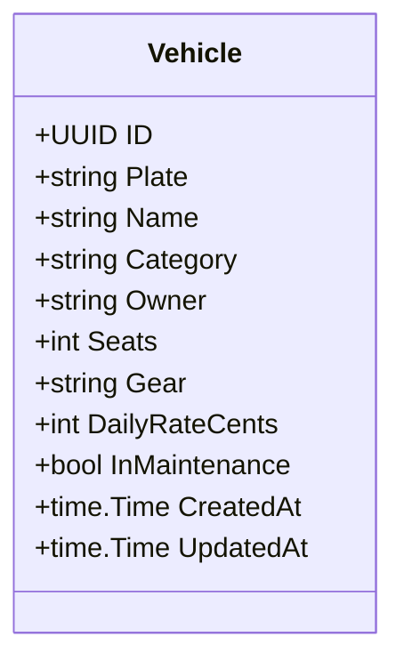

# RN-01 — Frota

## Regras de Negócio

| ID | Regra | Status | Onde é aplicada | Pendências |
|---|---|---|---|---|
| RN-01.1 | Veículo em manutenção não aceita reservas, e esse estado prevalece sobre qualquer outro na exibição | implementada (05/11/2026) | `internal/domain/booking/repository/booking_repository.go:186` (recusa a reserva), `queryAvailable` (fora da disponibilidade). Manutenção é um estado do veículo, sem período | PEN-01 |
| RN-01.2 | Cada veículo tem uma tarifa diária própria, cadastrada pela central | implementada (05/11/2026; diária no veículo, e não na categoria, decidido pelo time) | `sql/migrations/V2_vehicles.up.sql:10`, `internal/domain/fleet/entity.go:52` (diária obrigatória, sem default) | PEN-02 |
| RN-01.3 | O estado exibido do veículo considera reservas futuras, não só a locação em curso | proposta | — (o protótipo mostra "Livre" com reserva confirmada). A API ainda não calcula estado; `GET /api/availability` responde por período | PEN-28 |
| RN-01.4 | Categorias de veículo: **Economy** e **Premium**, por enquanto | implementada (05/11/2026; aprovada em 03/11/2026, [ADR-0011](../../docs/adr/ADR-0011-escopo-de-lancamento-e-canais.md)) | `internal/domain/fleet/entity.go:11`, `CHECK` em `V2_vehicles.up.sql` | PEN-61 |
| RN-01.5 | Valores comerciais são **configurados pela operação**, nunca fixos no código: diária do aluguel, referência de preço do transfer, hora extra de espera, caução, franquia, percentuais de comissão e repasse e **limite de km por dia** (RN-02.18) | aprovada (04/11/2026, fundador: "deixe de forma configurável"; [ADR-0013](../../docs/adr/ADR-0013-pagamento-online-e-moedas.md); km em 05/11/2026) | — | PEN-02 |
| RN-01.6 | Depois da devolução, o veículo só volta a ficar disponível (e só sai para nova locação) com o **checklist de devolução aprovado**: combustível, estética e itens técnicos (nível de óleo, água e pastilhas de freio). Os itens do checklist são **configuráveis** pela operação | aprovada (05/11/2026, fundador, observação na q56) | — | PEN-18 |

**Fontes:** Dossiê F; Base v1.1 §4; código do protótipo; questionário do fundador em 03/11/2026 (RN-01.4), 04/11/2026 (RN-01.5) e 05/11/2026 (RN-01.6, dono dos veículos).

## Detalhes

- Não há bloqueio de manutenção por período, só o estado global do veículo. O tratamento de clientes afetados por manutenção inesperada não está definido (Dossiê F).
- Frota informada pelo fundador: **VW Jetta 2014 (Economy)** e **Mercedes-Benz C180 (Premium)** (03 e 04/11/2026), **os dois de parceiros** (05/11/2026), então o repasse ao dono (RN-03.6, RN-03.7) vale para toda a frota atual. Faltam documentos e situação (PEN-01). São dados de cadastro, não seed de código.
- RN-01.6 cria um estado entre "devolvido" e "disponível": o veículo aguarda o checklist. Isso afeta a disponibilidade de reservas coladas (devolução e retirada no mesmo dia, RN-02.2) e precisa de horário (PEN-29).
- RN-01.2 × RN-01.5: decidido em 05/11/2026 que a diária fica no veículo, editável pela central (`PUT /api/vehicles/:id`). O limite de km por dia (RN-02.18) e os itens do checklist (RN-01.6) ainda não têm cadastro. As tarifas do protótipo (R$150–320) são **inventadas** e não podem ir para o produto.

## Modelo (alvo)

Campos baseados no protótipo (`dist/data.js`). Documentos do veículo (CRLV, seguro) dependem de PEN-03.
