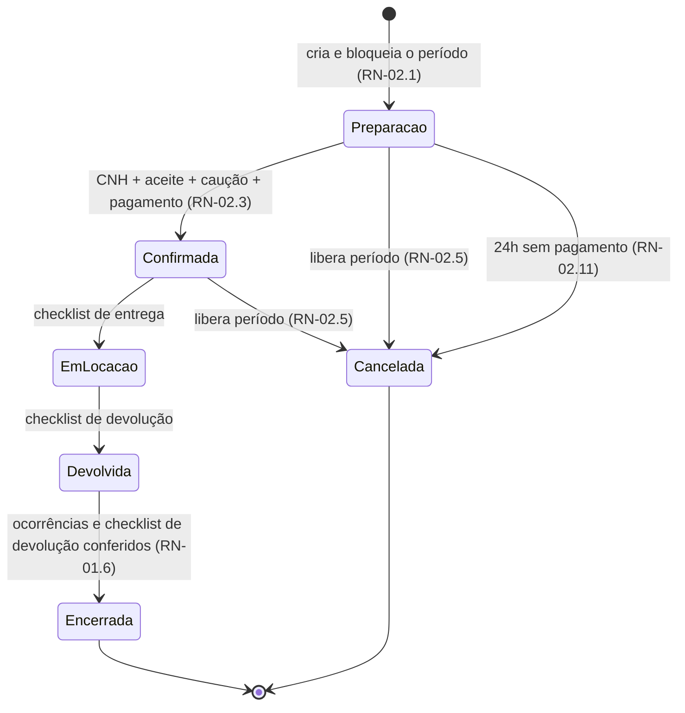
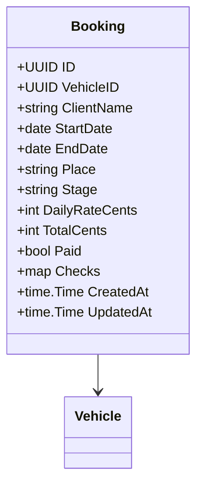

# RN-02 — Reservas e Ciclo de Locação

## Regras de Negócio

| ID | Regra | Status | Onde é aplicada | Pendências |
|---|---|---|---|---|
| RN-02.1 | O período fica bloqueado **desde a criação da reserva** (etapa "preparação") até ela ser cancelada, encerrada ou **expirar por falta de pagamento** (RN-02.11) | aprovada (03/11/2026, [ADR-0006](../../docs/adr/ADR-0006-momento-do-bloqueio-de-reserva.md); expiração em 04/11/2026, [ADR-0012](../../docs/adr/ADR-0012-pre-reserva-expira-em-24h.md)) | implementada (05/11/2026) | `sql/migrations/V5_bookings_horario.up.sql` (`EXCLUDE` por `tstzrange`), `internal/domain/booking/repository/booking_repository.go:172` | PEN-24 |
| RN-02.2 | Um veículo não pode ter duas reservas ativas (etapas 0–3) com períodos sobrepostos. Há sobreposição quando `início_novo < fim_existente` e `fim_novo > início_existente`. Períodos adjacentes são permitidos (devolver às 10h e retirar às 10h) | implementada (05/11/2026; por hora desde 06/11/2026) | `sql/migrations/V5_bookings_horario.up.sql` (`tstzrange` semiaberto) | PEN-29 |
| RN-02.3 | Confirmar a reserva exige CNH conferida, **aceite dos termos registrado no site** (sem assinatura eletrônica), caução e pagamento (RN-02.14, [RN-06](06-condutor-caucao-e-seguro.md)) | implementada como conferência (05/11/2026): `cnh`, `terms`, `deposit` e `payment` marcados pela central. O aceite no site e o pagamento online vêm depois | `internal/domain/booking/entity.go:27` | PEN-03, PEN-05 |
| RN-02.4 | A locação segue 5 etapas, em ordem, e cada avanço exige a conferência da etapa atual. Etapa encerrada ou cancelada não avança | implementada (05/11/2026) | `internal/domain/booking/entity.go:149`, `internal/domain/booking/repository/booking_repository.go:215` (só muda se a etapa ainda for a lida) | PEN-18, PEN-26 |
| RN-02.5 | Reserva em "preparação" ou "confirmada" pode ser cancelada, e o período volta a ficar disponível | implementada (05/11/2026; sem multa nem estorno, RN-02.21) | `internal/domain/booking/entity.go:167` | PEN-06 |
| RN-02.6 | Valor = diárias × tarifa do veículo **no momento da reserva**, gravado na reserva (não recalcula se a tarifa mudar) | implementada (05/11/2026) | `internal/domain/booking/repository/booking_repository.go:62` (`days`, `daily_rate_cents`, `total_cents` gravados) | PEN-02, PEN-27 |
| RN-02.7 | Retirada e devolução são data e hora válidas, validadas no servidor | implementada (05/11/2026; com hora desde 06/11/2026: AAAA-MM-DDTHH:MM no horário de Gramado ou RFC 3339; só a data continua aceita e vira 09:00) | `internal/domain/booking/entity.go` (`ParseInstant`, `ParsePeriod`) | PEN-25 |
| RN-02.8 | O cliente tem **24 horas** após a pré-reserva para pagar | aprovada (03/11/2026, fundador) | — | PEN-04 |
| RN-02.9 | Transfer de aeroporto: a central acompanha o voo em tempo real pelo número informado na reserva. **Até 60 minutos de espera no aeroporto estão inclusos**, sem acréscimo. Atrasos por trânsito, acidente, clima ou greve não geram responsabilidade da empresa | aprovada (03/11/2026, fundador: "mesmo padrão da Luxury"; FAQ e termos §6–7 de luxurybus.ch) | — | PEN-07 |
| RN-02.10 | **Transfer:** cancelamento **grátis até 24 horas antes** do serviço. Dentro das 24 horas, cobra-se **50% do valor**. Sem cobrança se o voo for cancelado pela companhia aérea. **Não vale para o aluguel**, que terá regra própria | aprovada (03/11/2026, fundador: "mesma regra da Luxury Bus"; FAQ de luxurybus.ch. Só transfer: 04/11/2026) | — | PEN-06 |
| RN-02.11 | Pré-reserva não paga em 24 horas é **cancelada automaticamente** e o período volta a ficar disponível. A disponibilidade ignora pré-reservas vencidas mesmo antes de a rotina cancelá-las | implementada (05/11/2026; aprovada em 04/11/2026, [ADR-0012](../../docs/adr/ADR-0012-pre-reserva-expira-em-24h.md)). "Paga" = conferência `payment` marcada | `internal/domain/booking/entity.go:22`, `internal/domain/booking/repository/booking_repository.go:26` | PEN-04 |
| RN-02.12 | Período mínimo de aluguel: **1 diária** | implementada (05/11/2026; aprovada em 04/11/2026, fundador) | `internal/domain/booking/entity.go:95`, `CHECK (days >= 1)` | PEN-02 |
| RN-02.13 | Combustível no aluguel sem motorista: **retira cheio e devolve cheio**. Se faltar, a diferença é cobrada, no mesmo formato da Localiza | aprovada (04/11/2026, fundador) | — | PEN-02 |
| RN-02.14 | O cliente paga **o valor integral ao reservar**, também quando o pedido chega por WhatsApp ou formulário. **No começo, por Pix ou link de pagamento, confirmado pela central**; o pagamento online integrado vem depois | aprovada (04/11/2026, [ADR-0013](../../docs/adr/ADR-0013-pagamento-online-e-moedas.md); meio do dia 1 em 05/11/2026, q53) | — | PEN-05 |
| RN-02.15 | Aluguel com motorista é **sempre sob consulta**, como o transfer | aprovada (04/11/2026, fundador) | — | PEN-02 |
| RN-02.16 | Transfer: a espera no aeroporto depois dos 60 minutos inclusos é **cobrada por hora** | aprovada (04/11/2026, fundador); valor da hora não informado | — | PEN-07 |
| RN-02.17 | Transfer: a corrida é **oferecida aos motoristas**, e o primeiro que aceitar fica com ela | aprovada (04/11/2026, fundador) | — | PEN-07 |
| RN-02.18 | Quilometragem do aluguel sem motorista é **acordada na contratação**: **km livre** ou **limite de km por dia**. Com limite, o **km excedente é cobrado** por km. Limite e valor do km são configuráveis pela operação e variam com a época e o fluxo (RN-01.5) | aprovada (05/11/2026, q55; formato e cobrança em 06/11/2026, q82) | — | PEN-02 |
| RN-02.19 | Devolução atrasada: **tolerância de 1 hora**; passado isso, cobra-se **uma diária extra** | implementada (06/11/2026; aprovada em 05/11/2026, q56): 1 diária extra por bloco de 24 horas iniciado depois da tolerância, pela diária da reserva, guardada em `extra_days` e `extra_cents`. Devolver antes não gera desconto | `internal/domain/booking/entity.go` (`LateDays`), `service/booking_service.go` (`record`), `V6_bookings_hora_real.up.sql` | PEN-02 |
| RN-02.20 | Extensão do aluguel: o cliente pede à central, que verifica a disponibilidade do veículo. Se estiver livre, o cliente **paga a diferença**; se não, a central **oferece outro veículo da mesma categoria** | aprovada (05/11/2026, fundador, q57) | — | PEN-02 |
| RN-02.21 | **Aluguel:** cancelamento **grátis até 48 horas antes** da retirada. Depois disso, cobra-se **1 diária**. Como a reserva já está paga (RN-02.14), o restante é estornado (RN-03.3) | aprovada (05/11/2026, fundador, q54) | — | PEN-06 |
| RN-02.22 | Transfer: se nenhum motorista aceitar a corrida, a **oferta é reaberta com valor maior para o motorista** | aprovada (05/11/2026, fundador, q59); prazo e acréscimo não informados | — | PEN-07 |
| RN-02.23 | Horário de retirada e devolução é **livre**, combinado com a central antes da retirada | implementada (06/11/2026; aprovada no mesmo dia, q66) | `start_at` e `end_at` na reserva (V5); campos de data e hora no painel | PEN-29 |
| RN-02.24 | A diária conta **períodos de 24 horas a partir da hora da retirada**, não dias do calendário. Junto com RN-02.19: até 1 hora além do último período não cobra; passado isso, cobra mais uma diária | implementada na reserva (06/11/2026; aprovada no mesmo dia, q67): `Period.Days` arredonda para cima em blocos de 24 horas. A cobrança do atraso na devolução (RN-02.19) ainda não, porque a hora real da devolução não é registrada | `internal/domain/booking/entity.go` (`Period.Days`) | PEN-29 |
| RN-02.25 | Entre uma devolução e a próxima retirada não há intervalo fixo: o carro **pode sair no mesmo dia**, desde que o checklist de devolução esteja aprovado (RN-01.6) | implementada (06/11/2026; aprovada no mesmo dia, q68): datas adjacentes já eram permitidas, e a entrega espera a reserva anterior sair de "devolvida" | `internal/domain/booking/repository/booking_repository.go` (`queryChecklistPending`) | PEN-29, PEN-18 |
| RN-02.26 | A central atende **24 horas, todos os dias**, por um único contato (o WhatsApp da central). Mais adiante, separa um contato de monitoramento 24h e um comercial | aprovada (06/11/2026, fundador, q69) | — | PEN-29, PEN-66 |
| RN-02.27 | Transfer: a corrida chega ao motorista **pelo WhatsApp, avisado pela central, e pelo painel ou app do motorista**. No início, de 2 a 5 motoristas | aprovada (06/11/2026, fundador, q83 e q84) | — | PEN-07 |

**Fontes:** Base v1.1 §3 e §5 (requisitos de 09/10/2025); Dossiê F; decisão do time em 03/11/2026 (RN-02.1); questionário do fundador em 03/11/2026 (RN-02.3, RN-02.8, RN-02.9), em 04/11/2026 (RN-02.10 a RN-02.17) em 05/11/2026 (RN-02.18 a RN-02.22) e em 06/11/2026 (RN-02.18, RN-02.23 a RN-02.27).

## Etapas

| Etapa | Código no protótipo | Conferência para avançar |
|---|---|---|
| Preparação | 0 | `cnh`, `contract`, `deposit` + pagamento |
| Confirmada | 1 | `out` (entrega) |
| Em locação | 2 | `back` (devolução) |
| Devolvida | 3 | `issues` (ocorrências) + itens ativos do checklist de devolução (RN-01.6) |
| Encerrada | 4 | — |
| Cancelada | −1 | — |

## Pontos em aberto

- Horário (PEN-29), implementado em 06/11/2026: a reserva guarda `start_at` e `end_at` (V5) e bloqueia por `tstzrange`. As reservas anteriores viraram 09:00 na retirada e na devolução, sem mudar as diárias. A API ainda devolve `start_date` e `end_date` (o dia em Gramado) e aceita só a data na criação, por compatibilidade. **Fuso:** suposição técnica de `America/Sao_Paulo` (operação em Gramado), embutido no binário (`internal/pkg/timezone`); o fundador não foi perguntado.
- Hora real (V6, 06/11/2026): ao avançar para "em locação" e para "devolvida", a central informa a hora real da entrega e da devolução (`delivered_at`, `returned_at`); sem informar, vale a hora do clique. Hora no futuro (mais de 5 minutos) e devolução antes da entrega são recusadas.
- RN-02.19, interpretação: "uma diária extra" foi lida como 1 diária por bloco de 24 horas iniciado depois da tolerância (25 horas de atraso = 2 diárias), coerente com RN-02.24. Confirmar com o fundador. O atraso é registrado na reserva; a cobrança é feita pela central (Pix ou link), como o pagamento (RN-02.14).
- Entrega bloqueada também quando o carro ainda está "em locação" em outra reserva (`ErrVehicleInUse`): não é regra de negócio nova, é impossibilidade física.
- **Conflito na q71 (06/11/2026), não resolvido:** o fundador marcou "aceite no site; **pagamento e caução na retirada**". Isso contradiz RN-02.14 e o [ADR-0013](../../docs/adr/ADR-0013-pagamento-online-e-moedas.md) (valor integral ao reservar, q37 e q53) e esvazia RN-02.11 (pré-reserva que não é paga em 24h expira). Até o fundador confirmar, vale o que está implementado: pagamento na reserva, confirmado pela central, e caução na retirada (a caução na retirada não contradiz nada).
- A API guarda do cliente só o nome. A CNH é uma conferência (`cnh: true`), sem número nem documento, até PEN-48.
- Pagamento integral na reserva (RN-02.14) faz toda reserva confirmada já estar paga. Cancelamento passa a significar sempre estorno (RN-03.3). O prazo e o meio do estorno dependem do provedor de pagamento (PEN-05).
- RN-02.18: confirmado em 06/11/2026 (q82) que o excedente é cobrado. O plano (livre ou limitado) e o limite precisam ficar na reserva, como a diária (RN-02.6).
- RN-02.19: a diária extra do atraso pode colidir com a reserva seguinte do mesmo veículo (RN-02.2), principalmente com retirada no mesmo dia (RN-02.25). Falta definir o que a central faz nesse caso.
- RN-02.20: o pedido de extensão passa pela central, sem autoatendimento no site.
- RN-02.22: faltam o prazo para alguém aceitar, o valor do acréscimo (configurável, RN-01.5?) e o que acontece se, mesmo assim, ninguém aceitar ou o motorista desistir (PEN-07). O valor da hora extra de espera é configurável (RN-01.5).
- A checagem do protótipo roda no navegador, então duas sessões podem reservar o mesmo período. Na API, o bloqueio deve ser atômico no banco (ex.: `EXCLUDE USING gist` com `daterange`) (PEN-24).

## Modelo (alvo)

`DailyRateCents` e `TotalCents` são gravados na criação (RN-02.6).
