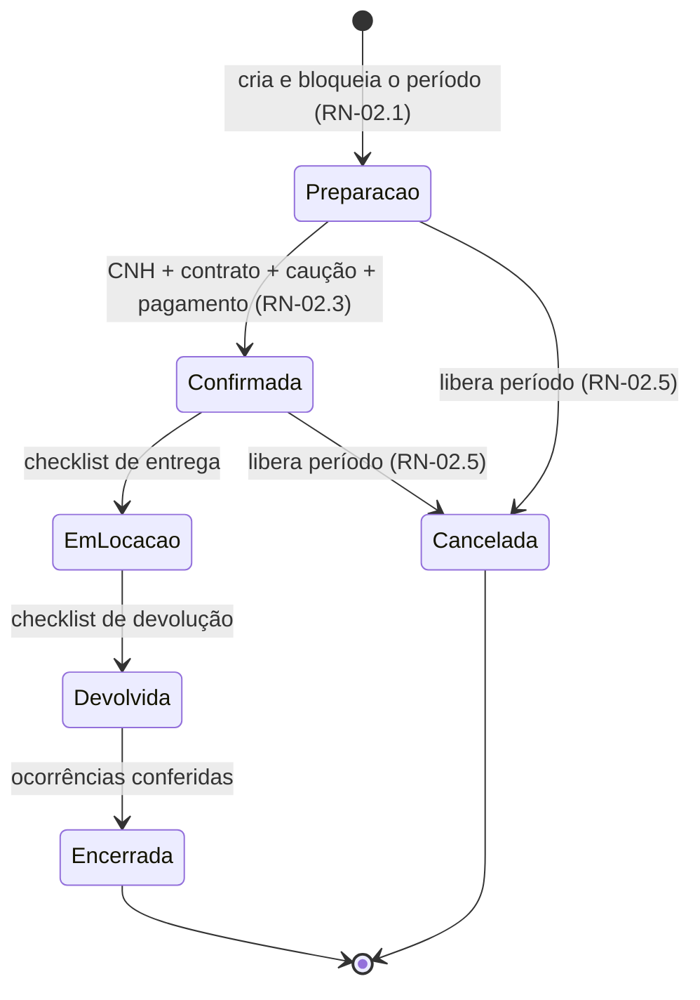
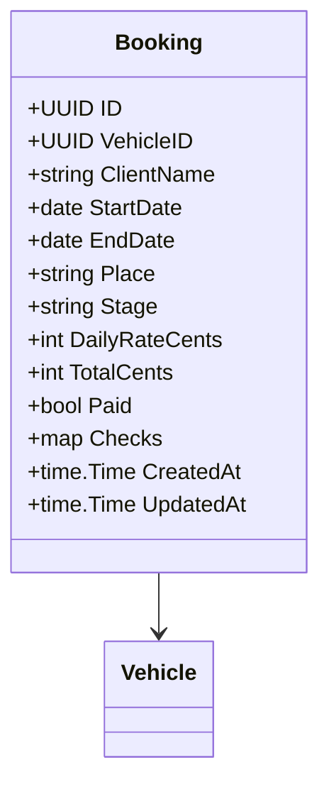

# RN-02 — Reservas e Ciclo de Locação

## Regras de Negócio

| ID | Regra | Status | Onde é aplicada | Pendências |
|---|---|---|---|---|
| RN-02.1 | O período fica bloqueado **desde a criação da reserva** (etapa "preparação") até ela ser cancelada ou encerrada, **sem prazo de expiração** | aprovada (03/11/2026, [ADR-0006](../../docs/adr/ADR-0006-momento-do-bloqueio-de-reserva.md)) | protótipo: `../neonflow-app/prototipo/dist/app.js:41`. API: a implementar com bloqueio atômico no banco | PEN-24 |
| RN-02.2 | Um veículo não pode ter duas reservas ativas (etapas 0–3) com períodos sobrepostos. Há sobreposição quando `início_novo < fim_existente` e `fim_novo > início_existente`. Datas adjacentes são permitidas | protótipo | `../neonflow-app/prototipo/dist/app.js:41` | PEN-29 |
| RN-02.3 | Confirmar a reserva exige CNH conferida, contrato, caução e pagamento | protótipo | `../neonflow-app/prototipo/dist/app.js:45` (`advance`) | PEN-03, PEN-05 |
| RN-02.4 | A locação segue 5 etapas, em ordem, e cada avanço exige a conferência da etapa atual. Etapa encerrada ou cancelada não avança | protótipo | `../neonflow-app/prototipo/dist/app.js:44-45` | PEN-18, PEN-26 |
| RN-02.5 | Reserva em "preparação" ou "confirmada" pode ser cancelada, e o período volta a ficar disponível | protótipo | `../neonflow-app/prototipo/dist/app.js:46` | PEN-06 |
| RN-02.6 | Valor = diárias × tarifa do veículo **no momento da reserva**, gravado na reserva (não recalcula se a tarifa mudar) | proposta | protótipo recalcula com a tarifa atual (`app.js:19`) | PEN-02, PEN-27 |
| RN-02.7 | Datas de retirada e devolução são datas de calendário válidas, validadas no servidor | proposta | protótipo aceita 30/02 | PEN-25 |

**Fontes:** Base v1.1 §3 e §5 (requisitos de 09/10/2025); Dossiê F; decisão do time em 03/11/2026 (RN-02.1).

## Etapas

| Etapa | Código no protótipo | Conferência para avançar |
|---|---|---|
| Preparação | 0 | `cnh`, `contract`, `deposit` + pagamento |
| Confirmada | 1 | `out` (entrega) |
| Em locação | 2 | `back` (devolução) |
| Devolvida | 3 | `issues` (ocorrências) |
| Encerrada | 4 | — |
| Cancelada | −1 | — |

## Pontos em aberto

- Horário de retirada/devolução, intervalo de limpeza e fuso: o protótipo usa 09:00 fixo (PEN-29).
- Multa, estorno e prazo de cancelamento (PEN-06).
- Prazo para pagamento após a criação: RN-02.1 define que **não há expiração**, mas o prazo comercial para pagar continua em aberto (PEN-04).
- A checagem do protótipo roda no navegador, então duas sessões podem reservar o mesmo período. Na API, o bloqueio deve ser atômico no banco (ex.: `EXCLUDE USING gist` com `daterange`) (PEN-24).

## Modelo (alvo)

`DailyRateCents` e `TotalCents` são gravados na criação (RN-02.6).
