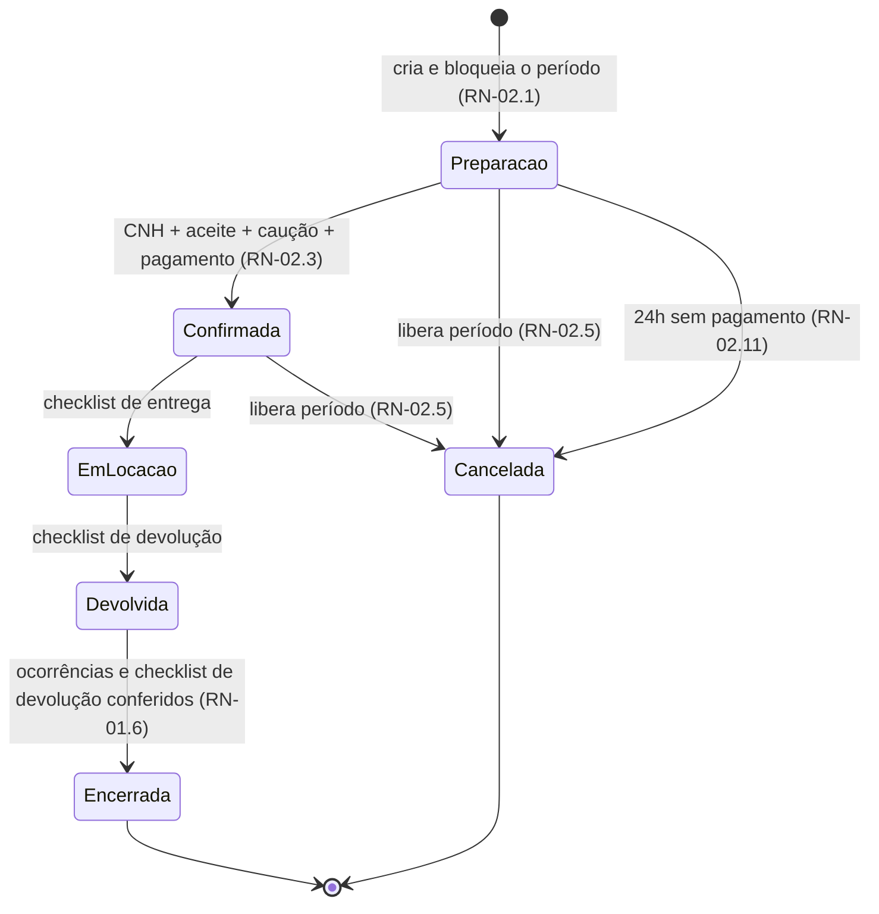
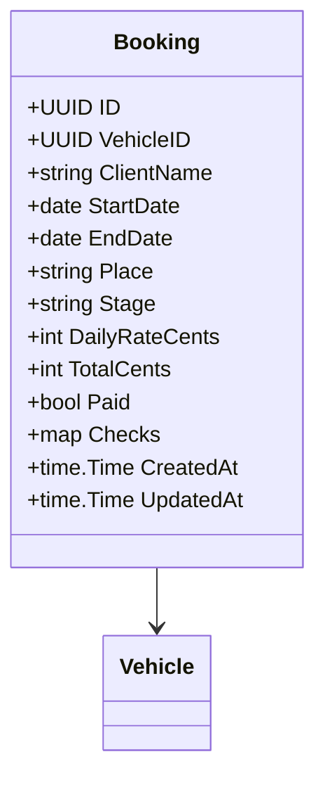

# RN-02 — Reservas e Ciclo de Locação

## Regras de Negócio

| ID | Regra | Status | Onde é aplicada | Pendências |
|---|---|---|---|---|
| RN-02.1 | O período fica bloqueado **desde a criação da reserva** (etapa "preparação") até ela ser cancelada, encerrada ou **expirar por falta de pagamento** (RN-02.11) | aprovada (03/11/2026, [ADR-0006](../../docs/adr/ADR-0006-momento-do-bloqueio-de-reserva.md); expiração em 04/11/2026, [ADR-0012](../../docs/adr/ADR-0012-pre-reserva-expira-em-24h.md)) | protótipo: `../neonflow-app/prototipo/dist/app.js:41`, sem expiração. API: a implementar com bloqueio atômico no banco | PEN-24 |
| RN-02.2 | Um veículo não pode ter duas reservas ativas (etapas 0–3) com períodos sobrepostos. Há sobreposição quando `início_novo < fim_existente` e `fim_novo > início_existente`. Datas adjacentes são permitidas | protótipo | `../neonflow-app/prototipo/dist/app.js:41` | PEN-29 |
| RN-02.3 | Confirmar a reserva exige CNH conferida, **aceite dos termos registrado no site** (sem assinatura eletrônica), caução e pagamento (RN-02.14, [RN-06](06-condutor-caucao-e-seguro.md)) | aprovada (04/11/2026, [ADR-0013](../../docs/adr/ADR-0013-pagamento-online-e-moedas.md)); o protótipo usa contrato em vez de aceite | `../neonflow-app/prototipo/dist/app.js:45` (`advance`) | PEN-03, PEN-05 |
| RN-02.4 | A locação segue 5 etapas, em ordem, e cada avanço exige a conferência da etapa atual. Etapa encerrada ou cancelada não avança | protótipo | `../neonflow-app/prototipo/dist/app.js:44-45` | PEN-18, PEN-26 |
| RN-02.5 | Reserva em "preparação" ou "confirmada" pode ser cancelada, e o período volta a ficar disponível | protótipo | `../neonflow-app/prototipo/dist/app.js:46` | PEN-06 |
| RN-02.6 | Valor = diárias × tarifa do veículo **no momento da reserva**, gravado na reserva (não recalcula se a tarifa mudar) | proposta | protótipo recalcula com a tarifa atual (`app.js:19`) | PEN-02, PEN-27 |
| RN-02.7 | Datas de retirada e devolução são datas de calendário válidas, validadas no servidor | proposta | protótipo aceita 30/02 | PEN-25 |
| RN-02.8 | O cliente tem **24 horas** após a pré-reserva para pagar | aprovada (03/11/2026, fundador) | — | PEN-04 |
| RN-02.9 | Transfer de aeroporto: a central acompanha o voo em tempo real pelo número informado na reserva. **Até 60 minutos de espera no aeroporto estão inclusos**, sem acréscimo. Atrasos por trânsito, acidente, clima ou greve não geram responsabilidade da empresa | aprovada (03/11/2026, fundador: "mesmo padrão da Luxury"; FAQ e termos §6–7 de luxurybus.ch) | — | PEN-07 |
| RN-02.10 | **Transfer:** cancelamento **grátis até 24 horas antes** do serviço. Dentro das 24 horas, cobra-se **50% do valor**. Sem cobrança se o voo for cancelado pela companhia aérea. **Não vale para o aluguel**, que terá regra própria | aprovada (03/11/2026, fundador: "mesma regra da Luxury Bus"; FAQ de luxurybus.ch. Só transfer: 04/11/2026) | — | PEN-06 |
| RN-02.11 | Pré-reserva não paga em 24 horas é **cancelada automaticamente** e o período volta a ficar disponível. A disponibilidade ignora pré-reservas vencidas mesmo antes de a rotina cancelá-las | aprovada (04/11/2026, [ADR-0012](../../docs/adr/ADR-0012-pre-reserva-expira-em-24h.md)) | — | PEN-04 |
| RN-02.12 | Período mínimo de aluguel: **1 diária** | aprovada (04/11/2026, fundador) | — | PEN-02 |
| RN-02.13 | Combustível no aluguel sem motorista: **retira cheio e devolve cheio**. Se faltar, a diferença é cobrada, no mesmo formato da Localiza | aprovada (04/11/2026, fundador) | — | PEN-02 |
| RN-02.14 | O cliente paga **o valor integral ao reservar**, também quando o pedido chega por WhatsApp ou formulário. **No começo, por Pix ou link de pagamento, confirmado pela central**; o pagamento online integrado vem depois | aprovada (04/11/2026, [ADR-0013](../../docs/adr/ADR-0013-pagamento-online-e-moedas.md); meio do dia 1 em 05/11/2026, q53) | — | PEN-05 |
| RN-02.15 | Aluguel com motorista é **sempre sob consulta**, como o transfer | aprovada (04/11/2026, fundador) | — | PEN-02 |
| RN-02.16 | Transfer: a espera no aeroporto depois dos 60 minutos inclusos é **cobrada por hora** | aprovada (04/11/2026, fundador); valor da hora não informado | — | PEN-07 |
| RN-02.17 | Transfer: a corrida é **oferecida aos motoristas**, e o primeiro que aceitar fica com ela | aprovada (04/11/2026, fundador) | — | PEN-07 |
| RN-02.18 | Aluguel sem motorista tem **limite de km por dia, configurável** pela operação, porque varia com a época e o fluxo (RN-01.5) | aprovada (05/11/2026, fundador, q55) | — | PEN-02 |
| RN-02.19 | Devolução atrasada: **tolerância de 1 hora**; passado isso, cobra-se **uma diária extra** | aprovada (05/11/2026, fundador, q56) | — | PEN-02 |
| RN-02.20 | Extensão do aluguel: o cliente pede à central, que verifica a disponibilidade do veículo. Se estiver livre, o cliente **paga a diferença**; se não, a central **oferece outro veículo da mesma categoria** | aprovada (05/11/2026, fundador, q57) | — | PEN-02 |
| RN-02.21 | **Aluguel:** cancelamento **grátis até 48 horas antes** da retirada. Depois disso, cobra-se **1 diária**. Como a reserva já está paga (RN-02.14), o restante é estornado (RN-03.3) | aprovada (05/11/2026, fundador, q54) | — | PEN-06 |
| RN-02.22 | Transfer: se nenhum motorista aceitar a corrida, a **oferta é reaberta com valor maior para o motorista** | aprovada (05/11/2026, fundador, q59); prazo e acréscimo não informados | — | PEN-07 |

**Fontes:** Base v1.1 §3 e §5 (requisitos de 09/10/2025); Dossiê F; decisão do time em 03/11/2026 (RN-02.1); questionário do fundador em 03/11/2026 (RN-02.3, RN-02.8, RN-02.9), em 04/11/2026 (RN-02.10 a RN-02.17) e em 05/11/2026 (RN-02.18 a RN-02.22).

## Etapas

| Etapa | Código no protótipo | Conferência para avançar |
|---|---|---|
| Preparação | 0 | `cnh`, `contract`, `deposit` + pagamento |
| Confirmada | 1 | `out` (entrega) |
| Em locação | 2 | `back` (devolução) |
| Devolvida | 3 | `issues` (ocorrências) |
| Encerrada | 4 | — |
| Cancelada | −1 | — |

## Pontos em aberto

- Horário de retirada/devolução, intervalo de limpeza e fuso: o protótipo usa 09:00 fixo (PEN-29).
- Pagamento integral na reserva (RN-02.14) faz toda reserva confirmada já estar paga. Cancelamento passa a significar sempre estorno (RN-03.3). O prazo e o meio do estorno dependem do provedor de pagamento (PEN-05).
- RN-02.18: a cobrança do km excedente não foi dita explicitamente; o formato da pergunta (q55) previa cobrança, com valor configurável. Confirmar na implementação.
- RN-02.19: a diária extra do atraso pode colidir com a reserva seguinte do mesmo veículo (RN-02.2). Falta definir o que a central faz nesse caso (PEN-29).
- RN-02.20: o pedido de extensão passa pela central, sem autoatendimento no site.
- RN-02.22: faltam o prazo para alguém aceitar, o valor do acréscimo (configurável, RN-01.5?) e o que acontece se, mesmo assim, ninguém aceitar ou o motorista desistir (PEN-07). O valor da hora extra de espera é configurável (RN-01.5).
- A checagem do protótipo roda no navegador, então duas sessões podem reservar o mesmo período. Na API, o bloqueio deve ser atômico no banco (ex.: `EXCLUDE USING gist` com `daterange`) (PEN-24).

## Modelo (alvo)

`DailyRateCents` e `TotalCents` são gravados na criação (RN-02.6).
