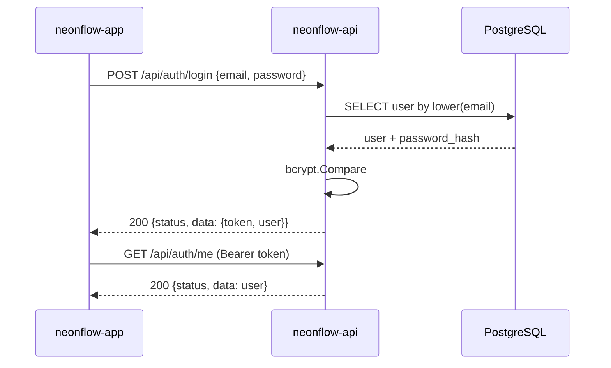

# RN-05 — Autenticação e Autorização

## Regras de Negócio

| ID | Regra | Status | Onde é aplicada | Pendências |
|---|---|---|---|---|
| RN-05.1 | Toda rota `/api/*`, exceto login e health, exige JWT válido (`Authorization: Bearer`) | implementada | `internal/pkg/middleware/auth.go` | — |
| RN-05.2 | Não há cadastro aberto: usuários da central são criados pela CLI `create-admin` | implementada | `cmd/create-admin` | PEN-14 |
| RN-05.3 | Papéis do token: `admin` e `central`. Perfis de cliente, motorista, captador e proprietário ainda não existem | implementada (só admin/central) | `internal/pkg/middleware/role_guard.go` | PEN-14, PEN-49 |
| RN-05.4 | Senhas guardadas com bcrypt. E-mail é único e comparado sem diferenciar maiúsculas | implementada | `internal/pkg/security/hasher.go`, `sql/migrations/V1_initial_schema.up.sql` | — |
| RN-05.5 | Falha de login responde a mesma mensagem para e-mail inexistente e senha errada | implementada | `internal/domain/authentication/service` | — |

**Fontes:** padrão dos projetos cognia/finder; decisão do scaffold em 03/11/2026. A matriz de perfis do produto depende de PEN-14.

## Fluxo de login

