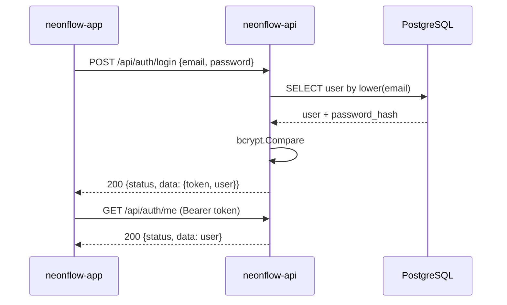

# RN-05 — Autenticação e Autorização

## Regras de Negócio

| ID | Regra | Status | Onde é aplicada | Pendências |
|---|---|---|---|---|
| RN-05.1 | Toda rota `/api/*`, exceto login e health, exige JWT válido (`Authorization: Bearer`) | implementada | `internal/pkg/middleware/auth.go` | — |
| RN-05.2 | Não há cadastro aberto: usuários do painel são criados pelo **admin no painel** (`/usuarios`) ou pela CLI `create-admin` | implementada (CLI em 03/11/2026; painel em 06/11/2026) | `internal/domain/user`, `cmd/create-admin` | PEN-14 |
| RN-05.3 | Papéis: `admin`, `central` e `legal_reviewer` (revisora jurídica, só nas rotas de contratos, [RN-08.4](08-contratos.md)). O token identifica o usuário (`user_id`) e o papel do login; o que vale em cada requisição é o papel atual no banco (RN-05.8). Perfis de cliente, motorista, captador e proprietário ainda não existem | implementada (admin/central; legal_reviewer em 08/11/2026, V20) | `internal/pkg/authz/authz.go`, `internal/pkg/middleware/auth.go` | PEN-14, PEN-49 |
| RN-05.4 | Senhas guardadas com bcrypt. E-mail é único e comparado sem diferenciar maiúsculas | implementada | `internal/pkg/security/hasher.go`, `sql/migrations/V1_initial_schema.up.sql` | — |
| RN-05.5 | Falha de login responde a mesma mensagem para e-mail inexistente e senha errada | implementada | `internal/domain/authentication/service` | — |
| RN-05.6 | No início, **só o fundador** (como admin e atendente da central) usa o painel. Parceiros (hotéis, proprietários de veículos, indicadores) e motoristas ganham acesso depois | aprovada (06/11/2026, fundador, q78) | papéis `admin` e `central` já existem | PEN-14 |
| RN-05.7 | O admin cria, edita, desativa e redefine a senha de usuários. Usuário desativado não entra e perde a sessão no próximo `/auth/me`. O admin não pode se desativar nem tirar o próprio papel de admin. Cada usuário troca a própria senha informando a atual | implementada (06/11/2026; decisão do time para operar RN-05.6 sem acesso ao servidor) | `internal/domain/user`, `V8_users_active.up.sql`, `auth_repository.go` (`AND active`) | PEN-14 |

| RN-05.8 | A cada requisição a API confere o usuário do token no banco: **desativado perde o acesso na hora** (401) e a **troca de papel vale sem novo login** | implementada (16/11/2026; pedido no CLI: "identificação de usuários dentro do token por role [...] middleware de validação de papel"; fecha o limite da RN-05.7) | `internal/pkg/middleware/auth.go` (`Accounts`), `internal/infra/api/store.go` (`ActiveRole`) | — |
| RN-05.9 | **Rotas auditadas:** toda chamada de usuário identificado que altera dados (POST, PUT, PATCH, DELETE, inclusive o login) e todo acesso negado por perfil (403) gravam quem, papel, método, rota, caminho, resultado e hora. Leituras permitidas não entram. A trilha é **só de inclusão** e não guarda corpo, query string nem dados pessoais. O admin consulta em Auditoria | implementada (16/11/2026; pedido no CLI: "rotas auditadas"; o recorte do que entra é decisão técnica) | `internal/pkg/middleware/audit.go`, `V22_audit_log.up.sql`, `internal/domain/audit` | — |
| RN-05.10 | **Controle por permissão:** cada papel tem uma lista de permissões e cada grupo de rotas exige uma: `operacao` (admin, central), `contratos` (admin, legal_reviewer), `clientes.anonimizar`, `termos.publicar`, `usuarios` e `auditoria` (só admin). Sem ela, 403. O login e o `/auth/me` devolvem `permissions`, e o painel monta o menu, as telas e o layout por essa lista | implementada (16/11/2026; pedido no CLI: "controle de acessos e permissões, versionamento de layout de acordo com o perfil logado"); a matriz repete o acesso que cada papel já tinha | `internal/pkg/authz/authz.go`, `internal/pkg/middleware/permission_guard.go`; app: `src/app/layout/profiles.ts` | PEN-14 |

**Fontes:** padrão dos projetos cognia/finder; decisão do scaffold em 03/11/2026; questionário do fundador em 06/11/2026 (RN-05.6). A matriz de perfis dos parceiros e do cliente (RN-04.6) depende de PEN-14.

~~**Limite conhecido (RN-05.7):** o token de quem foi desativado continuava aceito até expirar (12 h).~~ Resolvido em 16/11/2026 pela RN-05.8: o middleware confere `active` e o papel no banco a cada requisição (uma consulta por chave primária).

## Fluxo de login

