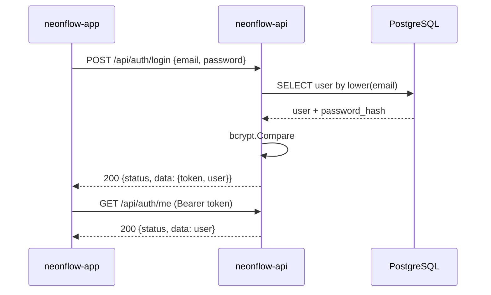

# RN-05 — Autenticação e Autorização

## Regras de Negócio

| ID | Regra | Status | Onde é aplicada | Pendências |
|---|---|---|---|---|
| RN-05.1 | Toda rota `/api/*`, exceto login e health, exige JWT válido (`Authorization: Bearer`) | implementada | `internal/pkg/middleware/auth.go` | — |
| RN-05.2 | Não há cadastro aberto **para a equipe**: usuários do painel são criados pelo **admin no painel** (`/usuarios`) ou pela CLI `create-admin`. Parceiro entra por convite e cliente pelo cadastro no site (RN-05.12, RN-05.13) | implementada (CLI em 03/11/2026; painel em 06/11/2026) | `internal/domain/user`, `cmd/create-admin` | PEN-14 |
| RN-05.3 | Papéis: `admin`, `central` e `legal_reviewer` (revisora jurídica, só nas rotas de contratos, [RN-08.4](08-contratos.md)), mais `parceiro` (proprietário, motorista ou indicador, RN-05.12) e `cliente` (RN-05.13). O token identifica o usuário (`user_id`) e o papel do login; o que vale em cada requisição é o papel atual no banco (RN-05.8) | implementada (admin/central; legal_reviewer em 08/11/2026, V20; parceiro e cliente em 16/11/2026, V23) | `internal/pkg/authz/authz.go`, `internal/pkg/middleware/auth.go` | PEN-14, PEN-49 |
| RN-05.4 | Senhas guardadas com bcrypt. E-mail é único e comparado sem diferenciar maiúsculas | implementada | `internal/pkg/security/hasher.go`, `sql/migrations/V1_initial_schema.up.sql` | — |
| RN-05.5 | Falha de login responde a mesma mensagem para e-mail inexistente e senha errada | implementada | `internal/domain/authentication/service` | — |
| RN-05.6 | ~~No início, só o fundador usa o painel; parceiros e motoristas ganham acesso depois.~~ **Revista em 16/11/2026:** parceiros de qualquer tipo (proprietário, motorista, indicador) e clientes entram na aplicação, cada um na própria área. A operação da central continua só com admin e central | revista (16/11/2026, fundador, CLI: "a idéia é que o parceiro possa fazer login na aplicação, parceiro seja ele qual for e também o cliente"; antes: 06/11/2026, q78) | RN-05.11 a RN-05.14 | PEN-14 |
| RN-05.7 | O admin cria, edita, desativa e redefine a senha de usuários. Usuário desativado não entra e perde a sessão no próximo `/auth/me`. O admin não pode se desativar nem tirar o próprio papel de admin. Cada usuário troca a própria senha informando a atual | implementada (06/11/2026; decisão do time para operar RN-05.6 sem acesso ao servidor) | `internal/domain/user`, `V8_users_active.up.sql`, `auth_repository.go` (`AND active`) | PEN-14 |

| RN-05.8 | A cada requisição a API confere o usuário do token no banco: **desativado perde o acesso na hora** (401) e a **troca de papel vale sem novo login** | implementada (16/11/2026; pedido no CLI: "identificação de usuários dentro do token por role [...] middleware de validação de papel"; fecha o limite da RN-05.7) | `internal/pkg/middleware/auth.go` (`Accounts`), `internal/infra/api/store.go` (`ActiveRole`) | — |
| RN-05.9 | **Rotas auditadas:** toda chamada de usuário identificado que altera dados (POST, PUT, PATCH, DELETE, inclusive o login) e todo acesso negado por perfil (403) gravam quem, papel, método, rota, caminho, resultado e hora. Leituras permitidas não entram. A trilha é **só de inclusão** e não guarda corpo, query string nem dados pessoais. O admin consulta em Auditoria | implementada (16/11/2026; pedido no CLI: "rotas auditadas"; o recorte do que entra é decisão técnica) | `internal/pkg/middleware/audit.go`, `V22_audit_log.up.sql`, `internal/domain/audit` | — |
| RN-05.10 | **Controle por permissão:** cada papel tem uma lista de permissões e cada grupo de rotas exige uma: `operacao` (admin, central), `contratos` (admin, legal_reviewer), `clientes.anonimizar`, `termos.publicar`, `usuarios` e `auditoria` (só admin). Sem ela, 403. O login e o `/auth/me` devolvem `permissions`, e o painel monta o menu, as telas e o layout por essa lista | implementada (16/11/2026; pedido no CLI: "controle de acessos e permissões, versionamento de layout de acordo com o perfil logado"); a matriz repete o acesso que cada papel já tinha | `internal/pkg/authz/authz.go`, `internal/pkg/middleware/permission_guard.go`; app: `src/app/layout/profiles.ts` | PEN-14 |
| RN-05.11 | **Conta ligada ao cadastro:** a conta de parceiro aponta para o parceiro e a de cliente para o cliente; uma conta por cadastro, e o banco recusa conta da equipe ligada a cadastro. Parceiro tem a permissão `area.parceiro` e cliente `area.cliente`; nenhum dos dois entra na operação da central (403). Em Usuários o admin vê e edita só a equipe | implementada (16/11/2026; decisão técnica para a RN-05.6 revista) | `V23_contas_parceiros_e_clientes.up.sql` (`users_account_link_check`), `internal/pkg/authz/authz.go` (`StaffRole`), `user_repository.go` (`staffOnly`) | PEN-14 |
| RN-05.12 | **Parceiro entra por convite:** a central convida o parceiro ativo que tem e-mail; ele recebe o link por e-mail e define a senha, e a conta nasce com o e-mail confirmado. Parceiro desativado não entra e perde a sessão na hora, como o usuário desativado (RN-05.8) | implementada (16/11/2026; convite pela central: decisão técnica, o cadastro aberto foi escolhido só para o cliente) | `POST /api/partners/:id/invite`, `POST /api/public/accounts/accept-invite`, `account_service.go` (`InvitePartner`), `store.go` (`queryActiveRole`) | PEN-14, PEN-16 |
| RN-05.13 | **Cliente se cadastra no site** com nome, e-mail e senha e só entra depois de confirmar o e-mail pelo link. Ao confirmar, a conta passa a apontar para o cadastro da central com o mesmo e-mail (o histórico dele); sem cadastro, ou com mais de um, cria um novo. O cadastro responde igual quando o e-mail já tem conta, sem revelar quem é cliente; conta ainda sem confirmar recebe o link de novo. Anonimizar o cliente (RN-04.8) apaga a conta | implementada (16/11/2026, fundador, CLI: cadastro pelo próprio cliente, com verificação do e-mail pelo Resend) | `POST /api/public/accounts/signup` e `/confirm`, `account_repository.go` (`ConfirmEmail`, `customerFor`), `auth_service.go` (`ErrEmailNotVerified`) | PEN-15, PEN-79 |
| RN-05.14 | **Nova senha por e-mail** para qualquer conta ativa e confirmada; a resposta não revela se o e-mail tem conta. Links de uso único, guardados só pelo hash: confirmação do e-mail por 24 horas, convite por 7 dias, nova senha por 1 hora; usar a nova senha fecha os outros links de nova senha da conta | implementada (16/11/2026, fundador, CLI: "por e-mail"; os prazos são decisão técnica) | `POST /api/public/accounts/forgot-password` e `/reset-password`, `account/entity.go` (`*TTL`), `account_tokens` (V23) | PEN-78, PEN-79 |

**Fontes:** padrão dos projetos cognia/finder; decisão do scaffold em 03/11/2026; questionário do fundador em 06/11/2026 (RN-05.6). CLI em 16/11/2026 (RN-05.6 revista, RN-05.11 a RN-05.14, [ADR-0016](../../docs/adr/ADR-0016-envio-de-email-pelo-resend.md)). O que cada parceiro e o cliente veem na própria área depende de PEN-14.

~~**Limite conhecido (RN-05.7):** o token de quem foi desativado continuava aceito até expirar (12 h).~~ Resolvido em 16/11/2026 pela RN-05.8: o middleware confere `active` e o papel no banco a cada requisição (uma consulta por chave primária).

## Fluxo de login

