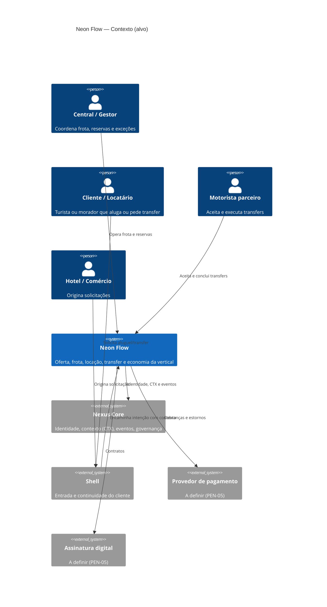
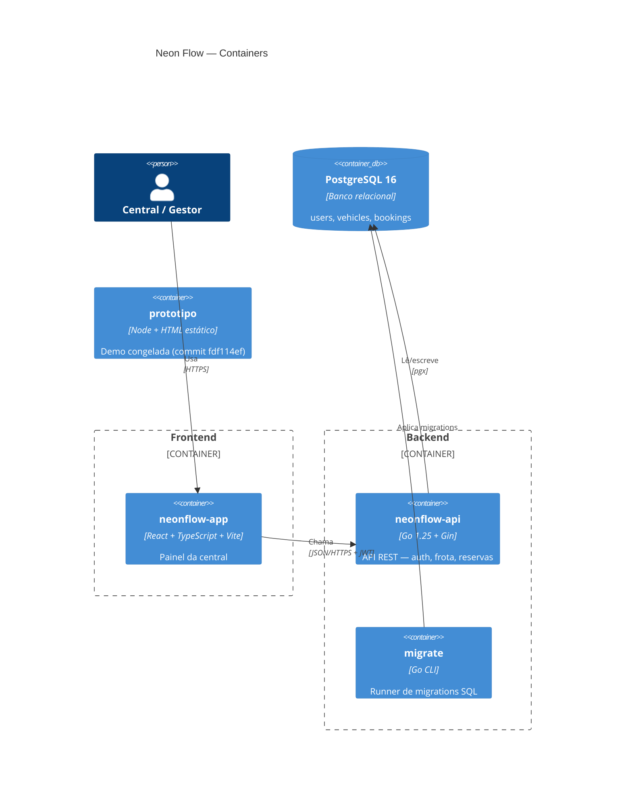

# Regras de Negócio — Neon Flow

> Regras da vertical de aluguel e mobilidade. Cada regra cita a fonte e o status.
> Manter sincronizado com o código: ao implementar uma regra, preencha "Onde é aplicada".

## Status

| Status | Significado |
|---|---|
| **aprovada** | Decisão explícita do fundador/time, com data |
| **implementada** | Existe no `neonflow-api`/`neonflow-app` com teste |
| **protótipo** | Existe só em `../neonflow-app/prototipo/dist/` — não aprovada como regra de produto |
| **proposta** | Sugerida em documento, sem aprovação |

**Nenhuma regra comercial (tarifa, caução, multa, comissão) está aprovada.** Ver `docs/pendencias.md` (PEN-01 a PEN-12). Não invente valores: sem fonte, abra uma pendência.

## Índice

| Arquivo | Área |
|---|---|
| `01-frota.md` | Veículos, manutenção e tarifa |
| `02-reservas.md` | Ciclo de locação, bloqueio de período, cancelamento e valor |
| `03-financeiro-e-comissoes.md` | Caução, recebimento e comissão por origem |
| `04-dados-e-integracoes.md` | Dados entre verticais e integrações com o Nexus |
| `05-autorizacao.md` | Autenticação e papéis |

---

## C4 — Nível 1: Contexto do Sistema

## C4 — Nível 2: Containers

Hoje existem o `neonflow-api` (este repositório, scaffold: health + auth), o `neonflow-app` (repo irmão, scaffold: login + telas vazias) e o `prototipo` (dentro do `neonflow-app`). Frota e reservas ainda não foram implementados.
