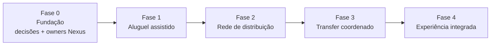

# Roadmap proposto

> **Defasado em 11/11/2026:** as fases 1 a 3 já foram em boa parte construídas sem esperar a fase 0 (PEN-52, ADR-0009). A sequência atual são os sete pacotes do fundador, em [pendencias.md](../pendencias.md) e [decisoes.md](../decisoes.md); falta ele confirmar a ordem (PEN-20).

**Status: proposta não aprovada** (PEN-20). A ordem depende do que já existir no Nexus/Replit (PEN-35, PEN-36) e de autorização para implementar (PEN-52).

| Fase | Entrega | Evidência para avançar |
| --- | --- | --- |
| 0. Fundação | Regras de locação aprovadas (PEN-01 a PEN-06), donos Nexus localizados (PEN-35), LGPD (PEN-48), autorização (PEN-52) | Todas as bloqueantes de negócio e governança resolvidas |
| 1. Aluguel assistido | Oferta real, período, reserva, conferência, entrega e devolução ([plano de reserva persistente](../plano-reserva-persistente.md)) | Serviço concluído, disponibilidade correta, custos e pendências registrados |
| 2. Rede de distribuição | Hotel, comércio e motorista recebem página, material e origem identificada | Pedidos rastreáveis, atendimento efetivo, apuração conferida |
| 3. Transfer coordenado | Origem/destino, horário, motorista, aceite, substituição e conclusão | Serviço cumprido, tempo de resposta e resultado econômico medidos |
| 4. Experiência integrada | Passeios e necessidades seguintes da viagem | Demanda confirmada e parceiros capazes de cumprir |

A fase 0 não estava na sequência original de 29/09. Ela foi acrescentada para tornar explícito o que bloqueia a fase 1.
